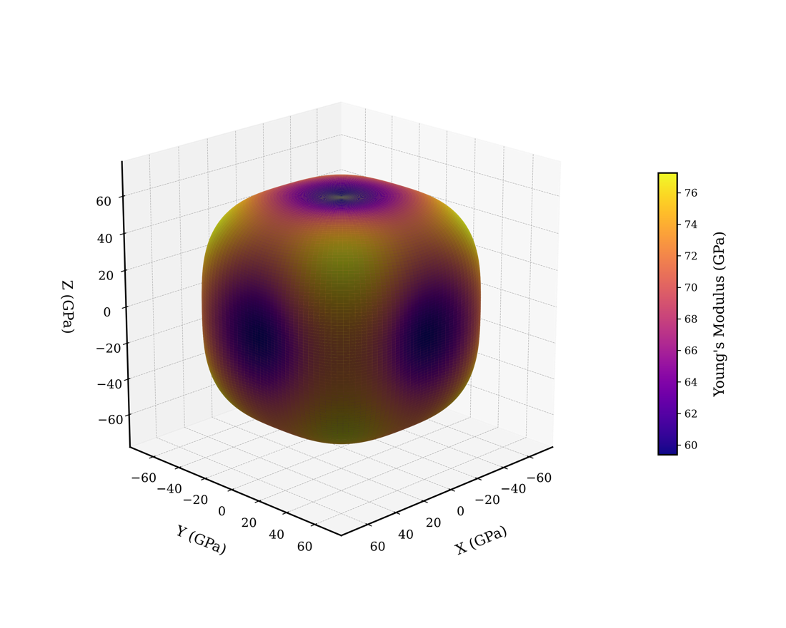
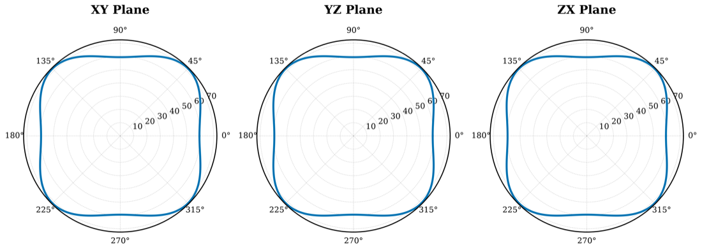
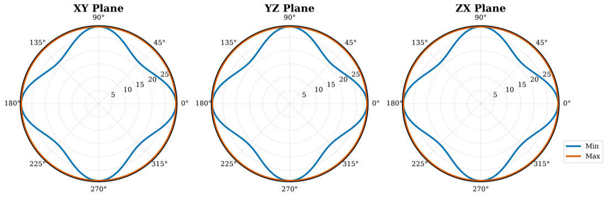
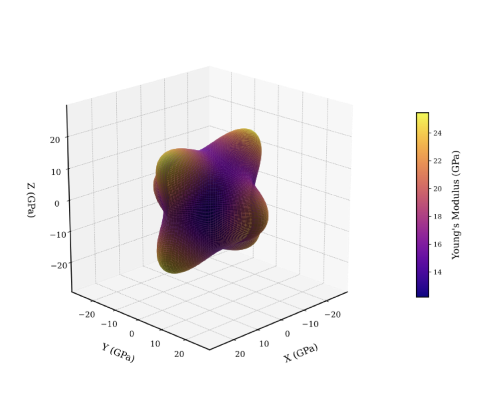
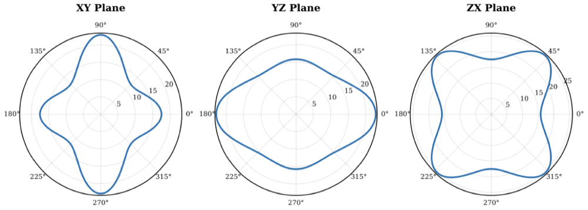
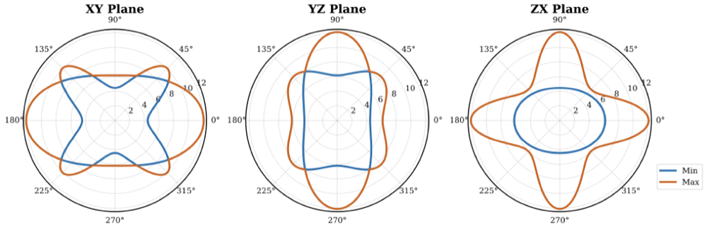
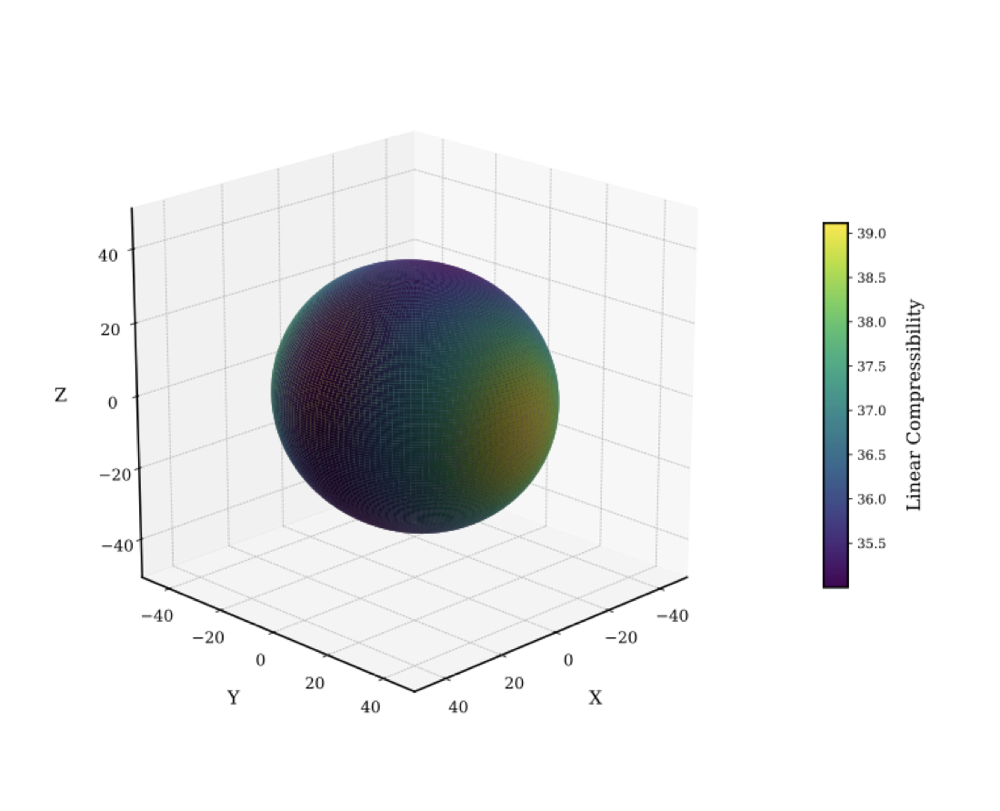

Visualise the results (optional)
================================

`elastic-vis <https://github.com/prabhat7iitm/elastic-vis>`_ is a companion package that
turns a 6×6 stiffness matrix into pictures of how the crystal's elastic properties depend
on direction:

* **Young's modulus**, **shear modulus**, **Poisson's ratio** and **linear
  compressibility** as functions of direction;
* **3D surfaces** and **2D polar plots** in the XY, YZ and ZX planes;
* Voigt, Reuss and Hill averages and the stability check as text;
* PNG, PDF or SVG output, styled through a JSON file.

It reads exactly the matrix that elastic_vasp writes with ``--output``: plain text, six
rows of six numbers in GPa.

From elastic_vasp to elastic-vis
--------------------------------

.. code-block:: bash

   # install elastic-vis (from its repository)
   git clone https://github.com/prabhat7iitm/elastic-vis.git
   pip install ./elastic-vis

   # stiffness matrix from your finished calculation
   elastic-vasp post cubic --output C.txt        # or: post auto --frame standard --output C.txt

   # directional plots
   elastic-vis C.txt --plot --Young --Shear --2D --3D --format png

For the automatic mode, ``--frame standard`` gives the plots in the crystal's standard
axes (cube axes, hexagonal c along z, …); without it they are drawn in the axes of your
POSCAR.

Example: aluminium from the worked example
------------------------------------------

The stiffness matrix of the :doc:`../worked_example` (fcc Al, PBE: :math:`C_{11} = 106.6`,
:math:`C_{12} = 63.4`, :math:`C_{44} = 28.9` GPa), saved with ``--output`` and plotted with

.. code-block:: bash

   elastic-vis C.txt --plot --Young --Shear --2D --3D --format png --output-prefix Al

elastic-vis also prints the Voigt, Reuss and Hill averages, which match the ones
``cubic_post`` printed (Hill: :math:`K = 77.78`, :math:`G = 25.75`, :math:`E = 69.57` GPa,
:math:`\nu = 0.351`).

   Young's modulus of Al: lowest along the cube axes ⟨100⟩
   (:math:`1/S_{11} = 59.4` GPa) and highest along the body diagonals ⟨111⟩ (77.2 GPa).

   The same in the three cube planes – identical, as they must be for a cubic crystal.

   Shear modulus of Al, between :math:`(C_{11}-C_{12})/2 = 21.6` GPa and
   :math:`C_{44} = 28.9` GPa. Al is only mildly anisotropic: its Zener ratio
   :math:`A = 2C_{44}/(C_{11}-C_{12})` is 1.34 (1 would be isotropic).

Example: a strongly anisotropic crystal
---------------------------------------

These figures come from the elastic-vis examples, for its example orthorhombic stiffness
matrix (``examples/matrix.txt`` in that repository):

.. math::

   C = \begin{pmatrix}
   20.49 & 0.55 & 7.42 & 0 & 0 & 0 \\
   0.55 & 23.12 & 2.17 & 0 & 0 & 0 \\
   7.42 & 2.17 & 18.61 & 0 & 0 & 0 \\
   0 & 0 & 0 & 6.18 & 0 & 0 \\
   0 & 0 & 0 & 0 & 12.08 & 0 \\
   0 & 0 & 0 & 0 & 0 & 4.46
   \end{pmatrix}\ \text{GPa}

   Young's modulus as a 3D surface: the distance from the origin in each direction is
   the Young's modulus along that direction.

   Young's modulus in the three coordinate planes.

   Shear modulus in the three coordinate planes (for each direction the minimum and
   maximum over the shear plane).

   Linear compressibility – how much the crystal shrinks along each direction under
   hydrostatic pressure.

A perfectly isotropic material would give a sphere and circles; the lobes show the
elastic anisotropy.

The aluminium figures were made with elastic-vis 0.1.0 for this documentation; the
orthorhombic figures are © elastic-vis authors, from
`github.com/prabhat7iitm/elastic-vis <https://github.com/prabhat7iitm/elastic-vis>`_
(MIT licence according to its README).

.. admonition:: Next
   :class: tip

   For crystals that are not in the standard orientation see :doc:`orientation` and
   :doc:`auto`; for all commands see :doc:`cli`.
