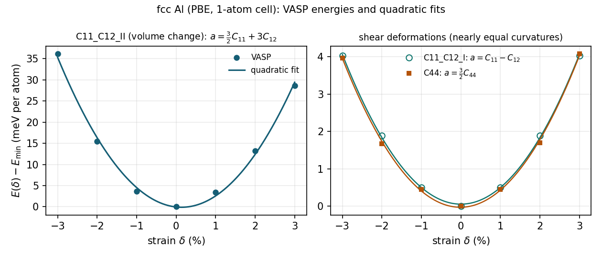
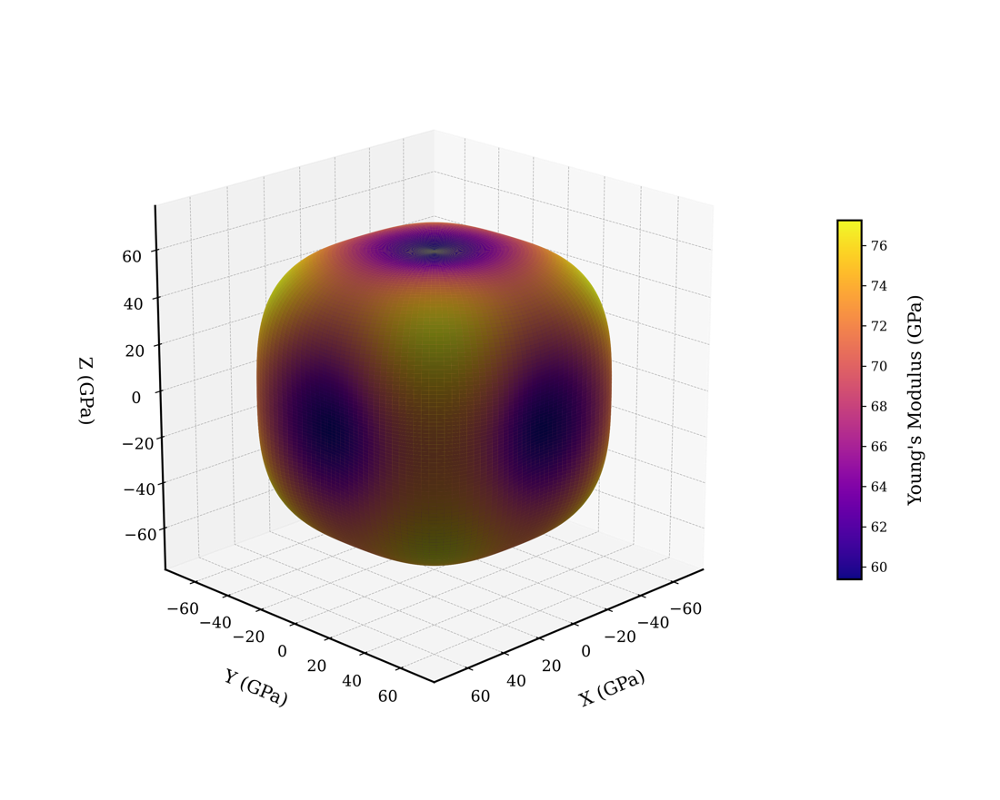

Worked example: fcc aluminium
=============================

A complete run with real VASP 6.4.2 output – from the structure to the stiffness matrix –
plus a check that a rotated cell gives the same answer through the automatic mode. All
numbers on this page come from these calculations.

Setup
-----

The one-atom primitive cell of fcc Al (cube axes along x, y, z), PBE.

.. code-block:: text
   :caption: INCAR

   ENCUT  = 400
   PREC   = Accurate
   EDIFF  = 1E-8
   ISMEAR = -5            ! tetrahedron method: smooth total energies for a metal
   IBRION = -1
   NSW    = 0             ! one atom per cell: nothing to relax

.. code-block:: text
   :caption: KPOINTS

   20x20x20 Gamma-centred
   0
   Gamma
    20 20 20
    0 0 0

``ISMEAR = -5`` is fine here because the single atom never moves; for crystals whose atoms
relax inside the strained cell use ``ISMEAR = 1`` and a dense mesh instead (see
:doc:`guide/workflow`).

0. Lattice constant
-------------------

The reference cell must be at its equilibrium volume for these settings. A 7-point
energy–volume scan (±1.5 % in the lattice constant), fitted with a Birch–Murnaghan
equation of state, gives

.. math::

   a_0 = 4.0391\ \text{Å}, \qquad V_0 = 16.474\ \text{Å}^3, \qquad B_0 = 77.0\ \text{GPa}.

1. Check
--------

.. code-block:: bash

   elastic-vasp check

.. code-block:: text

   POSCAR: Al (1 atoms)
   Space group:        Fm-3m (225) – cubic (Laue class m-3m), spglib symprec = 0.001 A
   Elastic constants:  3 independent (C11, C12, C44 in this orientation)
   Recommended:        cubic_pre() / cubic_post()  – works in this orientation
   Also works:         tetragonal_1, tetragonal_2, orthogonal, monoclinic, triclinic (more calculations)
   Any orientation:    auto_pre() / auto_post() – 3 deformations

2. Generate
-----------

.. code-block:: bash

   elastic-vasp pre cubic --max-strain 0.03 --points 7

Three deformations × seven strains (−3 % … +3 %) = 21 VASP runs. On 12 cores (one core per
run) the 21 runs took about three minutes.

3. Run VASP and analyse
-----------------------

.. code-block:: bash

   elastic-vasp post cubic --output C.txt

The fitted curvatures and what they measure:

.. list-table::
   :header-rows: 1
   :widths: 25 40 35

   * - Folder
     - Equation
     - Fitted :math:`a` (GPa)
   * - ``C11_C12_I``
     - :math:`a = C_{11} - C_{12}`
     - 43.24
   * - ``C11_C12_II``
     - :math:`a = \tfrac32 C_{11} + 3 C_{12}`
     - 349.99
   * - ``C44``
     - :math:`a = \tfrac32 C_{44}`
     - 43.40

   VASP energies (points) and the quadratic fits for the three deformations. The
   volume-changing deformation (left) is visibly asymmetric – anharmonicity, which the
   quadratic fit averages out; the two shear deformations (right) happen to have almost
   the same curvature.

Solving the three equations gives the stiffness matrix:

.. math::

   C = \begin{pmatrix}
   106.6 & 63.4 & 63.4 & 0 & 0 & 0 \\
   63.4 & 106.6 & 63.4 & 0 & 0 & 0 \\
   63.4 & 63.4 & 106.6 & 0 & 0 & 0 \\
   0 & 0 & 0 & 28.9 & 0 & 0 \\
   0 & 0 & 0 & 0 & 28.9 & 0 \\
   0 & 0 & 0 & 0 & 0 & 28.9
   \end{pmatrix}\ \text{GPa}

and the rest of the report:

.. code-block:: text

    structure is mechanically stable
   ===== Polycrystalline Average =====
   K_voigt= 77.78  GPa
   K_reuss= 77.78  GPa
   K_VRH= 77.78  GPa
   G_voigt= 26.01  GPa
   G_reuss= 25.49  GPa
   G_VRH= 25.75  GPa
   E_VRH= 69.57  GPa
   nu_VRH= 0.35
   Pugh ratio= 3.02

Two independent checks agree: the bulk modulus from the elastic constants,
:math:`(C_{11} + 2C_{12})/3 = 77.8` GPa, matches the equation-of-state value of 77.0 GPa,
and the constants fall in the range of PBE values usually reported for Al
(roughly :math:`C_{11} \approx 103\text{–}110`, :math:`C_{12} \approx 57\text{–}63`,
:math:`C_{44} \approx 28\text{–}33` GPa).

Directional plots
-----------------

Saving the matrix with ``--output C.txt`` and passing it to elastic-vis gives the
direction dependence – here Young's modulus, from 59.4 GPa along ⟨100⟩ to 77.2 GPa along
⟨111⟩ (more in :doc:`guide/visualise`):

   Young's modulus of fcc Al in every direction, plotted with elastic-vis.

Same crystal, rotated cell, automatic mode
------------------------------------------

The same cell rigidly rotated (Euler angles 25°, 40°, 10°), run through the automatic
mode – no rotation back, no choice of workflow:

.. code-block:: bash

   elastic-vasp pre auto --max-strain 0.03 --points 7
   elastic-vasp post auto --frame standard --output C_standard.txt

``auto_pre`` found Fm-3m and chose three deformations (``e1+e3``, ``e2-e3``, ``e1+e4``);
``auto_post`` reported the matrix in the rotated frame and, rotated back, in the standard
setting:

.. list-table::
   :header-rows: 1
   :widths: 40 20 20 20

   * - Route
     - :math:`C_{11}`
     - :math:`C_{12}`
     - :math:`C_{44}`
   * - ``cubic_pre`` / ``cubic_post``, standard cell
     - 106.6
     - 63.4
     - 28.9
   * - ``auto_pre`` / ``auto_post``, rotated cell
     - 107.9
     - 62.7
     - 30.3

The two routes use different deformations (and therefore differently reduced k-point
sets), so they agree to within the remaining numerical noise of about 1–1.5 GPa.

Lessons from getting here
-------------------------

Two earlier attempts on a 4-atom conventional cell did **not** give usable numbers:

* With only the **Γ point**, the energy *decreased* under strain (the unstrained cubic cell
  has degenerate states at the Fermi level, which strain splits), so the fitted constants
  were meaningless.
* With a **12×12×12 mesh and Methfessel–Paxton smearing**, the k-point noise (~1 meV per
  cell) was as large as the signal at ±2 % strain (2–8 meV): the zero-strain energy was not
  the lowest point of the curve, and C11 − C12 came out at a fraction of its value.

What fixed it: the one-atom cell (much cheaper per k-point), a dense 20×20×20 mesh,
``ISMEAR = -5``, a lattice constant from the equation of state, and ±3 % strains. Always
look at the curves (``plot.jpg`` / ``Result.txt`` in each deformation folder) before
trusting the numbers – see :doc:`guide/workflow` for what to look for.
